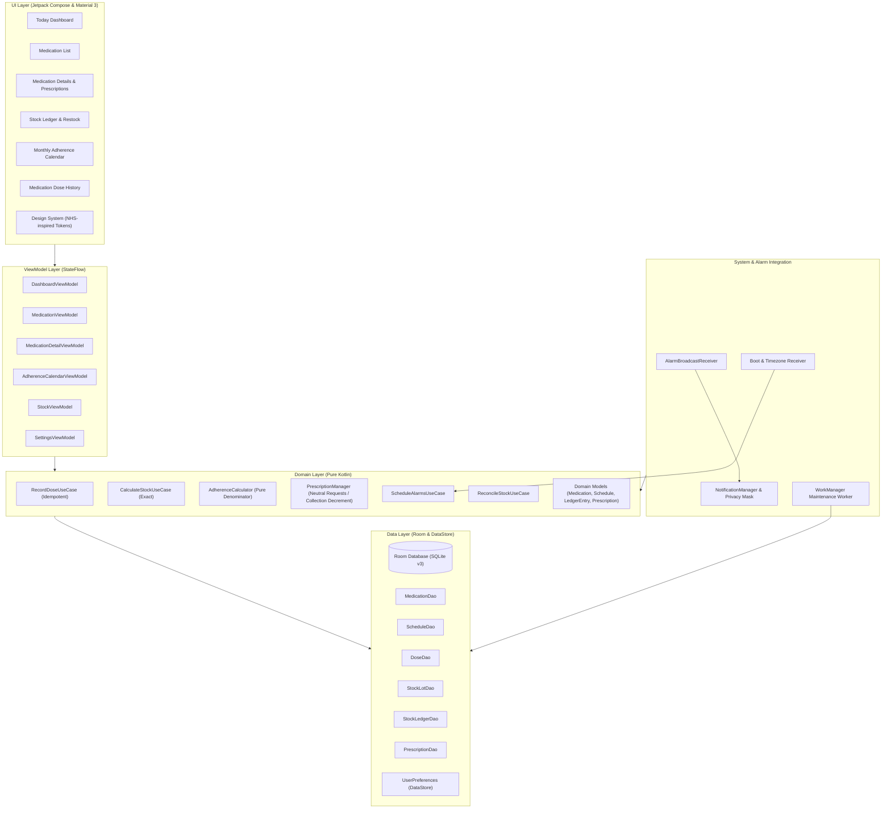

# Novelo System Architecture

This document describes the architectural patterns, package layout, data boundaries, and technical decisions governing **Novelo**.

---

## 1. Architectural Principles

1. **Local-First & Zero-Network**: No internet permission, no cloud synchronisation, no external telemetry.
2. **Unidirectional Data Flow (UDF)**: State flows down from ViewModels; events and intents flow up from Compose UI.
3. **Ledger-Backed Truth**: Stock levels and dose adherence are mathematically computed from immutable event logs, not mutable counters.
4. **Resilient Scheduling**: Two-tier background system using `AlarmManager` for real-time dose delivery and `WorkManager` for non-critical maintenance.

---

## 2. System Architecture Diagram



---

## 3. Package & Directory Structure

```
com.example.nuvilo/ (or com.novelo.app)
├── data/
│   ├── local/
│   │   ├── NoveloDatabase.kt
│   │   ├── converters/           # Room TypeConverters (Instant, Enums, ScaledInt)
│   │   ├── dao/
│   │   │   ├── MedicationDao.kt
│   │   │   ├── DoseEventDao.kt
│   │   │   ├── StockLedgerDao.kt
│   │   │   └── PrescriptionDao.kt
│   │   └── entity/               # Room Entities with foreign keys & indices
│   │       ├── MedicationEntity.kt
│   │       ├── ScheduleEntity.kt
│   │       ├── DoseEventEntity.kt
│   │       ├── StockLedgerEntryEntity.kt
│   │       └── PrescriptionEntity.kt
│   ├── preferences/
│   │   └── UserPreferencesRepository.kt # DataStore for theme, app-lock, privacy mode
│   └── repository/
│       ├── MedicationRepositoryImpl.kt
│       ├── DoseRepositoryImpl.kt
│       ├── StockRepositoryImpl.kt
│       └── PrescriptionRepositoryImpl.kt
├── domain/
│   ├── adherence/
│   │   └── AdherenceCalculator.kt # Pure Kotlin adherence math, deterministic occurrence resolution & DST handling
│   ├── prescription/
│   │   └── PrescriptionManager.kt # Domain state machine for repeat requests & collection decrements
│   ├── model/                    # Pure Kotlin domain data classes
│   │   ├── DomainModels.kt       # Medication, Schedule, DoseEvent, StockLot, Prescription, PrescriptionEvent
│   │   ├── Enums.kt              # PrescriptionStatus, PrescriptionEventType, MovementType, DoseStatus
│   │   └── ScaledQuantity.kt     # Exact scaled integer math (no floating point)
│   ├── repository/               # Domain repository interfaces
│   │   ├── NoveloRepository.kt   # PrescriptionRepository, MedicationRepository, etc.
│   │   └── DoseRepository.kt
│   └── usecase/
│       ├── RecordDoseUseCase.kt  # Transactional dose confirmation + stock deduction
│       ├── CalculateStockUseCase.kt # Exact math for balances and days remaining
│       ├── ScheduleDoseAlarmUseCase.kt
│       └── AdjustStockUseCase.kt # Auditable inventory corrections
├── system/
│   ├── alarm/
│   │   ├── AlarmScheduler.kt     # AlarmManager wrapper (canScheduleExactAlarms)
│   │   └── AlarmReceiver.kt      # Wakeful broadcast receiver handling exact alarms
│   ├── notification/
│   │   ├── NotificationActionReceiver.kt # Handles "Take", "Snooze", "Skip" intents
│   │   └── NotificationHelper.kt # Channel setup, privacy text masking, sound/vibe
│   ├── receiver/
│   │   └── BootAndChangeReceiver.kt # Reconciles alarms on boot, timezone, time set
│   └── work/
│       └── StockCheckWorker.kt   # WorkManager for daily low-stock evaluations
└── ui/
    ├── common/                   # Reusable Design System components
    │   ├── TopAppBar.kt
    │   ├── MedicationCard.kt
    │   ├── StockBadge.kt
    │   ├── DoseStatusIndicator.kt
    │   └── Buttons.kt
    ├── navigation/               # Type-safe Navigation Compose routes
    │   └── NoveloDestinations.kt
    ├── screens/
    │   ├── dashboard/            # Today timeline & action cards
    │   ├── medication/           # Medication list, detail, and edit flows
    │   ├── stock/                # Stock ledger, restock dialog, adjustments
    │   ├── history/              # Adherence timeline & calendar view
    │   ├── prescription/         # Script tracker & refill countdowns
    │   └── settings/             # Notification privacy, app lock, backup/export
    └── theme/
        ├── Color.kt              # NHS Blue palette & dark surface tokens
        ├── Type.kt               # Legible typography scale
        └── Theme.kt              # MaterialTheme wrapper
```

---

## 4. Layer Responsibilities & Data Flow

### UI Layer (Compose & M3)
- Purely declarative UI with zero knowledge of database entities or SQL.
- Receives state exclusively as immutable Kotlin data classes from `ViewModel.uiState`.
- Dispatches UI events (e.g. `DashboardEvent.OnConfirmDose(occurrenceId)`) to ViewModels.

### Domain Layer (Pure Kotlin)
- Holds all business rules, validation, dose occurrence calculation, and stock math.
- Contains zero Android framework dependencies (no `android.content.Context` or `android.os.Bundle`), ensuring pure, lightning-fast unit testability.
- `RecordDoseUseCase` guarantees transactional idempotency:
  1. Checks if `occurrenceId` already exists in `dose_events`.
  2. If already confirmed, rejects duplicate execution.
  3. Inserts `DoseEvent` with status `TAKEN`.
  4. Inserts `StockLedgerEntry` with movement `OUT` and link to `doseEventId`.
  5. Updates cached medication balance column in the same transaction.
- **`AdherenceCalculator`**: Pure Kotlin adherence and calendar evaluation engine:
  - Evaluates adherence percentage strictly over eligible scheduled occurrences (denominator), excluding future occurrences.
  - Never invents historical occurrences prior to medication tracking start.
  - Resolves past unrecorded scheduled occurrences as `MISSED` deterministically without suggesting catch-up doses.
  - Explicitly segregates confirmed (`TAKEN`) from assumed (`ASSUMED`) doses.
  - Handles dose reversals (`DOSE_REVERSAL`) so original and reversed events are not counted as dual successes.
  - Handles Daylight Saving Time (DST) transitions cleanly via ZoneId-aware timestamps.
- **`PrescriptionManager`**: Domain state machine for prescription lifecycles:
  - Enforces repeat request neutrality: requesting a repeat records an audit event but does NOT decrement repeats remaining or alter stock.
  - Enforces repeat collection decrement: collecting a repeat decrements `repeatsRemaining` by exactly 1 (never below 0).
  - Enforces expiry guards: expired prescriptions cannot be presented as active or allow repeat actions.
  - Enforces idempotency via duplicate action keys to prevent accidental double-clicks.
  - Maintains an immutable audit trail of `PrescriptionEvent` entries.

### Data Layer (Room & SQLite)
- **Room SQLite Database (v3)**:
  - `foreignKeys` enforce referential integrity between `medications`, `schedules`, `dose_events`, `stock_lots`, `stock_ledger`, `prescriptions`, and `prescription_events`.
  - Indices on `occurrenceId`, `medicationId`, `prescriptionId`, and `timestamp` ensure millisecond query times even over years of records.
  - Migrations: `MIGRATION_1_2` (lot tracking and dose corrections), `MIGRATION_2_3` (prescriptions and prescription audit events).
  - Schema export maintained at `app/schemas/` with automated migration tests.
- **DataStore**: Stores key-value user preferences (Dark/Light mode, Biometric Lock enabled, Notification Privacy mode enabled, Quiet Hours start/end).

### System Integration Layer
- **`AlarmScheduler` (`AlarmSchedulerImpl`)**: Central coordinator for `AlarmManager`.
  - Determines exact alarm capabilities via `AlarmManager.canScheduleExactAlarms()` (Android 12+ / API 31+).
  - Uses `setExactAndAllowWhileIdle()` for battery-optimized wakeups, falling back to `setAndAllowWhileIdle()` when exact alarms are revoked.
  - Implements a bounded 3-day scheduling horizon (`reconcileUpcomingReminders(horizonDays = 3)`) to prevent unbounded alarm saturation.
  - Cancels obsolete alarms on schedule updates or medication archiving.
- **`AlarmReceiver`**: Wakeful broadcast receiver handling exact alarms from `AlarmManager`.
  - For `CONFIRM` medications, fetches current stock and posts actionable notification.
  - For `AUTO_ASSUME` medications, transactionally logs assumed adherence and deducts stock at scheduled time, then posts informative reminder.
  - Uses `goAsync()` to safely perform coroutine-based Room repository operations in the background.
- **`NotificationHelper`**: Manages Android Notification channels and presentation.
  - Dedicated channels: `novelo_medication_reminders` (`IMPORTANCE_HIGH`) and `novelo_low_stock_alerts` (`IMPORTANCE_DEFAULT`).
  - Privacy masking: Masks drug name, dosage, and stock when `isPrivacyModeEnabled` is set in DataStore preferences.
  - Content intent: Configures `FLAG_ACTIVITY_SINGLE_TOP` intent targeting `MainActivity` with `selected_medication_id` for instant navigation to `MedicationDetailScreen`.
- **`NotificationActionReceiver`**: Processes pending intent actions directly from the notification shade without activity launch (`android:exported="false"`):
  - `ACTION_TAKE`: Confirms dose and deducts stock transactionally and idempotently.
  - `ACTION_SKIP`: Marks dose skipped without stock impact; if dose was previously recorded under `AUTO_ASSUME`, executes compensating `DOSE_REVERSAL` ledger entry to restore stock.
  - `ACTION_SNOOZE`: Reschedules reminder alarm (+15 minutes) without modifying dose status or stock ledger.
- **`BootAndChangeReceiver`**: Protected system broadcast receiver (`android:exported="true"`) listening to `ACTION_BOOT_COMPLETED`, `ACTION_MY_PACKAGE_REPLACED`, `ACTION_TIMEZONE_CHANGED`, and `ACTION_TIME_CHANGED`.
  - Reconciles upcoming alarms for the next 3 days to recover from reboots, clock shifts, and daylight saving transitions.
  - Re-enqueues periodic WorkManager low-stock maintenance.
- **`LowStockCheckWorker`**: Deferrable background worker via WorkManager.
  - Runs periodically to evaluate stock balances against minimum thresholds.
  - Uses DataStore `lowStockNotifiedMedIds` to deduplicate notifications, resetting deduplication flags when a restock occurs.

---

## 5. Security & Privacy Boundaries

```mermaid
graph LR
    User([User]) <-->|Biometric / Credential Lock| UI[Novelo UI]
    UI <--> Room[Local Room DB]
    Room -.->|Explicit User Export| SAF[Android Storage Access Framework (SAF)]
    System[Android OS] <--> Alarm[AlarmManager / Exact Alarms]
    Alarm --> Notif[Notification shade]
    Notif -->|Privacy Masking| Lockscreen[Device Lockscreen]

    subgraph Prohibited_Zone [STRICTLY PROHIBITED]
        Internet((Internet / Cloud))
        Analytics((Analytics / Telemetry))
        ExternalAPI((External APIs))
    end

    Room x-.-x Prohibited_Zone
    UI x-.-x Prohibited_Zone
```

- **Manifest Boundaries**: Zero network permissions declared.
- **Auto-Backup Boundaries**: Android Auto Backup rules exclude private health database files.
- **Export Security**: Exported files are written directly to user-selected URIs via Android SAF, requiring explicit user initiation.

---

## 6. Error Handling & Recovery Strategy

- **Database Errors**: Wrapped in domain `Result<T>` sealed hierarchies (`Success`, `Failure(DomainError)`). ViewModels translate failures into non-disruptive snackbars or user-friendly error banners.
- **Alarm Clock Drift / Missed Alarms**: The `BootAndChangeReceiver` and app start check recalculate the next 7 days of scheduled alarm occurrences against database records, ensuring dropped alarms are recovered automatically.
- **Dose Record Conflict**: Handled idempotently via SQLite `OnConflictStrategy.ABORT` or explicit pre-check in `RecordDoseUseCase`, preventing crashes and ledger corruption.

---

## 7. UI/UX Architecture & Design System Tokens

### 7.1 Design Tokens & Theming (`ui/theme/`)
- **Primary Brand Color**: NHS-inspired blue (`#005EB8`), calm and authoritative without affiliation.
- **Dark Mode Foundation**: Slate navy surfaces with base container `#121820`, surface `#171F2B`, and background `#0C1015`.
- **Status Contrast Matrix**: High-contrast text/container pairs tested for WCAG AA compliance:
  - `StatusTaken` (`#007A3D`) / `StatusTakenContainer` (`#D8F3E5`)
  - `StatusAssumed` (`#005EB8`) / `StatusAssumedContainer` (`#D9EFFF`)
  - `StatusSkipped` (`#5C6B73`) / `StatusSkippedContainer` (`#E6ECEF`)
  - `StatusMissed` (`#BA1A1A`) / `StatusMissedContainer` (`#FFDAD6`)
  - `StatusWarning` (`#C05600`) / `StatusWarningContainer` (`#FFE7D6`)

### 7.2 Central Component Architecture (`ui/components/NoveloComponents.kt`)
- `HeroDoseCard`: Prominent, accessible callout for the next actionable dose today, with integrated Take, Skip, and Snooze (+15m) actions and minimum 48x48dp touch targets.
- `TimelineDoseItem`: Chronological schedule item with vertical track connector, status badge, scheduled time, and quick actions.
- `CompletedDayCard`: Reassuring state card displayed when all scheduled doses for the day have been completed.
- `AlertBanner`: High-visibility notification card for low-stock warnings and expiring prescriptions.
- `DoseStatusBadge`: Accessible badge pairing high-contrast semantic colors with distinct symbols (`✓`, `~`, `×`, `!`) to never convey status solely through color.
- `StockBadge`: Inventory health badge with threshold coloring (Normal, Low Stock, Depleted).
- `EmptyStateCard`: Educational placeholder for empty lists and schedules with contextual action buttons.

### 7.3 Edge-to-Edge & Accessibility Guidelines
- Window insets: Managed via Material 3 `Scaffold` safe drawing insets, avoiding double `statusBarsPadding()`.
- Keyboard overlap prevention: All interactive dialogs apply `Modifier.imePadding()` to ensure action buttons are never obstructed by virtual soft keyboards.
- Semantic tree: Section titles and headings declare `semantics { heading() }` for screen readers; decorative icons explicitly set `contentDescription = null`.

---

## 8. Privacy, Security & Local Backup Architecture (Phase 6)

### 8.1 Biometric & Credential Authentication Architecture (`security/`)
- **Framework**: AndroidX `BiometricPrompt` on `FragmentActivity`.
- **Authenticators**: `BIOMETRIC_STRONG` (fingerprint, 3D face) paired with `DEVICE_CREDENTIAL` (system PIN, pattern, password).
- **Negative Button Restriction**: Omitted when `DEVICE_CREDENTIAL` is set, compliant with Android platform specifications.
- **Biometric Evaluation (`BiometricAuthManager`)**:
  - `BiometricManager.canAuthenticate(BIOMETRIC_STRONG)` evaluates biometric hardware presence and enrollment.
  - `KeyguardManager.isDeviceSecure` detects device screen lock enrollment.
  - Returns `AVAILABLE`, `DEVICE_CREDENTIAL_ONLY`, `NONE_ENROLLED`, `NO_HARDWARE`, or `UNAVAILABLE`.
- **App Lock State Machine (`AppLockManager`)**:
  - Monotonic clock: Uses `SystemClock.elapsedRealtime()` via `MonotonicClock` interface to prevent clock tampering, manual adjustments, or DST manipulation from bypassing or triggering lockouts.
  - Lifecycle tracking: `onAppBackgrounded()` records timestamp; `onAppForegrounded(lockEnabled, gracePeriod)` calculates elapsed time.
  - Configurable grace periods: `IMMEDIATELY` (0s), `THIRTY_SECONDS` (30s), `ONE_MINUTE` (60s), `FIVE_MINUTES` (300s), `FIFTEEN_MINUTES` (900s).
  - System dialog suppression: `setSystemDialogActive(true)` prevents relocking during biometric prompts or SAF file pickers.
  - Cold-start invariant: When lock is enabled, `initialize(lockEnabled = true)` forces `_isLocked.value = true` immediately on launch.
- **Visual Gating (`LockScreen.kt`)**:
  - Rendered when `isLocked == true`.
  - Underlying screen hierarchy is omitted from the Compose composition, preventing TalkBack accessibility scraping or memory snooping of medication names.
  - System `BackHandler` calls `finish()` to exit the app rather than revealing underlying screens.
  - Window `FLAG_SECURE`: Dynamically added when locked or when `isRecentsPreviewMasked == true` to prevent recents screenshotting and screen recording.

### 8.2 Cryptographic Backup Format (`data/backup/BackupCrypto.kt`)
- **Key Derivation (KDF)**: PBKDF2 with HMAC-SHA256 (`PBKDF2WithHmacSHA256`), 100,000 iterations, 16-byte cryptographically secure random salt (`SecureRandom`), deriving a 256-bit AES key.
- **Symmetric Cipher**: AES-256 in Galois/Counter Mode (`AES/GCM/NoPadding`), 12-byte random IV/nonce, 128-bit authentication tag.
- **Passphrase Memory Sanitization**: Plaintext character arrays and derived key byte arrays are overwritten with zeroes (`Arrays.fill(..., 0)`) immediately after use.
- **Envelope JSON Schema**:
  ```json
  {
    "formatVersion": 1,
    "appVersion": "1.0",
    "schemaVersion": 3,
    "cipher": "AES/GCM/NoPadding",
    "kdf": "PBKDF2WithHmacSHA256",
    "kdfIterations": 100000,
    "saltBase64": "<16 bytes base64>",
    "nonceBase64": "<12 bytes base64>",
    "ciphertextBase64": "<AES-GCM ciphertext + 128-bit tag base64>"
  }
  ```

### 8.3 CSV ZIP Export Structure (`data/backup/CsvZipBackupManager.kt`)
- Full-fidelity data export bundled in an uncompressed or deflated ZIP archive containing:
  - `manifest.json`: Metadata, schema version, export epoch, table record counts.
  - `medications.csv`: 12 columns, RFC 4180 compliant escaping.
  - `schedules.csv`: 9 columns, CSV target times and days of week.
  - `dose_events.csv`: 10 columns, deterministic occurrence IDs and status.
  - `stock_lots.csv`: 9 columns, lot numbers and quantities.
  - `stock_ledger_entries.csv`: 11 columns, movement types, quantities, audit reasons.
  - `prescriptions.csv`: 14 columns, prescriber details, repeats, status.
  - `prescription_events.csv`: 8 columns, audit history.
- Null value token: `\N` used consistently to distinguish empty strings from SQL nulls.

### 8.4 Transactional Restore & Recovery (`data/backup/BackupRestoreRepositoryImpl.kt`)
- **Validation Stage (`BackupValidator`)**:
  - Validates format version (`<= 1`) and schema version (`<= 3`).
  - Verifies primary key uniqueness across all 7 entities.
  - Verifies referential integrity (foreign keys) across medications, schedules, doses, stock lots, stock ledger movements, and prescriptions.
- **Atomic Execution**: Executed inside `NoveloDatabase.withTransaction`:
  1. Deletes existing data in reverse dependency order (prescription events -> prescriptions -> ledger entries -> lots -> doses -> schedules -> medications).
  2. Inserts backup records in forward dependency order.
  3. 100% rollback guarantee: Any SQLite constraint failure rolls back the transaction, leaving existing data untouched.
- **Post-Restore Reconciliation**: Automatically triggers `AlarmScheduler.reconcileUpcomingReminders()` to sync `AlarmManager` with newly imported medication schedules.
