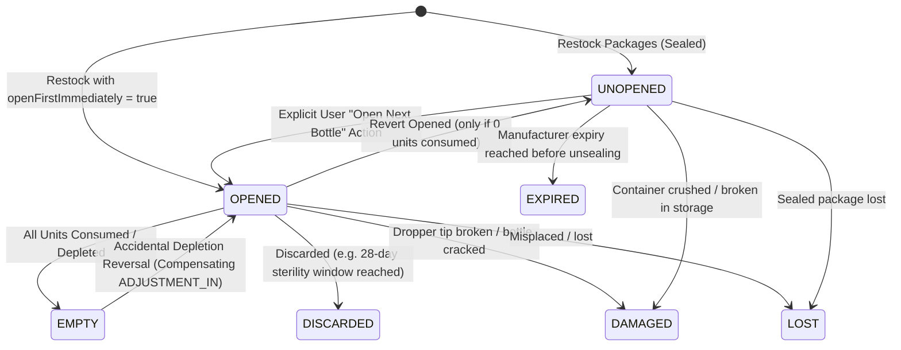

# Nuvilo Physical Package Inventory & Bottle Lifecycle Architecture
**Phase 10 Core Architectural Specification**  
**Author:** Agent 2 (`inventory-eng`) – Packaging, Stock Ledger & Consumption Engineer  
**Status:** Approved & Implemented  
**Date:** 2026-11-14  

---

## 1. Domain Separation of Units

Nuvilo establishes a strict three-tier unit model separating purchasing containers, container capacities, and clinical administration doses:

```
┌─────────────────────────────────┐
│     Purchasing Package Unit     │  PackageType: Bottle, Tube, Box, Blister Pack
│  (e.g., 7 Bottles of Eye Drops) │  Discrete, physical containers on the shelf
└────────────────┬────────────────┘
                 │ contains
                 ▼
┌─────────────────────────────────┐
│   Package Usable Capacity       │  Nominal contents per sealed container
│  (e.g., 300 Drops per Bottle)   │  ScaledQuantity (e.g. 300,000 raw fixed-point)
└────────────────┬────────────────┘
                 │ consumed by
                 ▼
┌─────────────────────────────────┐
│      Administration Dose        │  Prescribed clinical regimen
│  (e.g., 1 drop × 2 eyes = 2)    │  Deducted strictly from OPENED container
└─────────────────────────────────┘
```

### Invariants:
1. **Never Sell Raw Drops**: Users restock physical packages (e.g., "+7 bottles" or "+2 boxes"), not arbitrary quantities of liquid (such as "+2,100 drops").
2. **Deterministic Scaling**: All math uses `ScaledQuantity` integer thousandths ($10^3$). Strictly zero `Float` or `Double` arithmetic is permitted.
3. **Physical Container Count**: Total physical packages on hand = `openedCount + unopenedCount`. Opening an existing container decreases `unopenedCount` by 1 and increases `openedCount` by 1; the physical inventory count is unchanged.

---

## 2. Package Status Lifecycle & Transitions



### Transition Specifications:

| Status | Usable for Dosing? | Clock Active? | Permitted Next Transitions | Notes |
|---|---|---|---|---|
| `UNOPENED` | No | No | `OPENED`, `EXPIRED`, `DAMAGED`, `LOST` | Sealed reserve. Discard-after-opening clock is dormant. |
| `OPENED` | **Yes (Active)** | **Yes** | `EMPTY`, `UNOPENED` (revert), `DISCARDED`, `DAMAGED`, `LOST` | Current in-use container. Sterility clock active. |
| `EMPTY` | No | Finished | `OPENED` (reversal only) | All usable units exhausted or depleted early. |
| `EXPIRED` | No | Inactive | None (Terminal) | Manufacturer expiry date exceeded. |
| `DISCARDED` | No | Inactive | None (Terminal) | Manually discarded; remaining balance written off as `WASTAGE`. |
| `DAMAGED` | No | Inactive | None (Terminal) | Physical container damage; balance written off as `WASTAGE`. |
| `LOST` | No | Inactive | None (Terminal) | Container missing; balance written off as `WASTAGE`. |

---

## 3. Package Restocking with Immediate Opening Support

### API Contract (`NoveloRepository.kt` & `ViewModels.kt`):
```kotlin
suspend fun restockPackages(
    medicationId: String,
    packageCount: Int,
    contentsPerPackage: ScaledQuantity,
    consumptionUnit: StockUnit,
    packageType: PackageType,
    discardAfterOpeningDays: Int? = null,
    lotNumber: String? = null,
    expiryDateEpochMs: Long? = null,
    notes: String? = null,
    openFirstPackageImmediately: Boolean = false
): Result<Unit>
```

### Business Rules:
1. `openFirstPackageImmediately = true`:
   - Checks if an active `OPENED` package already exists for this medication.
   - If **no opened package exists**, Package #1 is initialized as `OPENED` (`openedAtEpochMs = nowMs`, `discardAfterOpeningEpochMs = nowMs + discardDays * 86_400_000L`).
   - If an opened package already exists, all newly restocked packages remain `UNOPENED` to prevent premature sterility clock expiration.
2. Packages #2 through #N are created as `UNOPENED`.
3. Total added quantity = `contentsPerPackage * packageCount`. An atomic `MovementType.RESTOCK` ledger movement records the total reserve added.

---

## 4. Accidental Opening Reversal (`revertOpenedPackage`)

When a user taps "Open Bottle" by mistake or unseals a digital card before physically breaking the bottle's tamper band:

```kotlin
fun revertOpenedPackage(lot: StockLot): StockLot {
    check(lot.packageStatus == PackageStatus.OPENED) {
        "Cannot revert package in status ${lot.packageStatus}; only OPENED packages can be reverted"
    }
    check(lot.remainingQuantity == lot.initialQuantity) {
        "Cannot revert package that has already been partially consumed (${lot.remainingQuantity.toDisplayString()} of ${lot.initialQuantity.toDisplayString()} remaining)"
    }
    return lot.copy(
        packageStatus = PackageStatus.UNOPENED,
        openedAtEpochMs = null,
        discardAfterOpeningEpochMs = null
    )
}
```

### Safety Invariants:
- Reversal is **strictly forbidden** if even a single drop has been recorded or deducted from the bottle (`remainingQuantity == initialQuantity`).
- Reverting clears `openedAtEpochMs` and `discardAfterOpeningEpochMs`, stopping the discard clock.

---

## 5. Early Package Depletion & Accidental Depletion Reversal

When a container runs dry early (e.g. 240 drops taken from a 300 nominal drop bottle):
1. **Compensating Outflow**: Writes off remaining 60 drops as `MovementType.WASTAGE` (`isEstimate = true`, `doseOccurrenceId = null`, `lotId = lot.id`).
2. **Package Status**: Transitions to `EMPTY` with `depletedAtEpochMs`, `depletionReason`, `depletionNote`.
3. **Preserved Capacity**: `initialQuantity` remains 300 drops. Recorded consumed doses remain intact.
4. **Zero Dose Fabrication**: `dose_events` is untouched. Adherence score is 100% unaffected.
5. **Reversal (`reopenDepletedPackage`)**:
   - Emits compensating `MovementType.ADJUSTMENT_IN` restoring previous balance (60 drops).
   - Reverts status back to `OPENED`.

---

## 6. Verification Summary

- `EarlyPackageDepletionTest`: 8 tests covering 240/300 scenario, zero dose fabrication, FEFO next staging, accidental reversal, and schema v4 mapping.
- `PackageRestockAndRevertTest`: 4 tests covering opening timestamps, reverting unconsumed bottle, rejection on partially consumed bottle, and status validation.
- All tests pass with zero errors.
