# Nuvilo Package Lifecycle & State Transition Specification
**Phase 10 Domain Architecture Document**  
**Author:** Agent 1 (`domain-auditor`) & Agent 2 (`inventory-eng`)  
**Status:** Approved & Implemented  
**Date:** 2026-11-14  

---

## 1. Executive Summary

In real-world medication adherence, physical containers (eye-drop bottles, tubes, blister packs, insulin vials) have distinct lifecycles independent of cumulative dose counters. 

Nuvilo models every discrete physical package as an identifiable entity within `stock_lots`. A package progresses through deterministic states governed by physical reality, clinical sterility limits, and explicit patient actions.

Crucially:
- **Zero Silent Auto-Opening**: Software must **never** automatically break the virtual seal of a new bottle or tube when an existing one runs dry. Explicit confirmation from the patient is required.
- **Zero Dose Fabrication**: When a container runs dry early, leaks, or is discarded, the unconsumed quantity is accounted for as `MovementType.WASTAGE`. Adherence history and dose event tables are never corrupted with fictional doses.
- **Deterministic Reversibility**: Human errors (accidental button taps) can be safely undone through auditable reversal operations (`revertOpenedPackage`, `reopenDepletedPackage`).

---

## 2. Package Status State Machine

The 7 discrete states of a physical package in Nuvilo are:

```mermaid
stateDiagram-v2
    [*] --> UNOPENED: Restock Packages (Default)
    [*] --> OPENED: Restock Packages (openFirstPackageImmediately = true)
    
    UNOPENED --> OPENED: Explicit User Action ("Open Bottle")
    OPENED --> UNOPENED: Revert Opening (Accidental tap; remaining == initial)
    
    OPENED --> EMPTY: Normal Consumption (All units taken)
    OPENED --> EMPTY: Early Depletion ("Mark Bottle Finished")
    EMPTY --> OPENED: Reopen Depleted (Compensating ADJUSTMENT_IN)
    
    OPENED --> DISCARDED: Discarded (e.g. 28-day sterility window reached)
    OPENED --> DAMAGED: Dropper tip cracked / contaminated
    OPENED --> LOST: Bottle misplaced
    
    UNOPENED --> EXPIRED: Manufacturer expiration reached in storage
    UNOPENED --> DAMAGED: Container crushed / broken in storage
    UNOPENED --> LOST: Sealed box misplaced
```



---

## 3. Comprehensive State Definitions

### 3.1 `UNOPENED`
- **Definition**: A factory-sealed, intact package stored in reserve.
- **Usability**: Sealed reserve. Cannot be directly deducted from for dose administration until opened.
- **Clocks**: The discard-after-opening sterility countdown is **dormant** (`openedAtEpochMs = null`, `discardAfterOpeningEpochMs = null`). Manufacturer expiration clock (`expiryDateEpochMs`) is active.
- **Permitted Transitions**:
  - `OPENED`: Triggered by explicit patient confirmation ("Open Next Bottle").
  - `EXPIRED`: Triggered if manufacturer expiration date is reached before unsealing.
  - `DAMAGED`: Triggered if sealed container is crushed or punctured.
  - `LOST`: Triggered if sealed container cannot be located.

### 3.2 `OPENED`
- **Definition**: The active, unsealed package currently being consumed by the patient.
- **Cardinality Invariant**: For medications requiring explicit unsealing (bottles, tubes, discard-window packs), **at most one** container may be in `OPENED` status simultaneously, unless explicitly configured for multi-site concurrent usage.
- **Usability**: **Active**. All scheduled doses deduct strictly from this container.
- **Clocks**: Sterility window is **active**. `openedAtEpochMs` is stamped. If `discardAfterOpeningDays` is defined, `discardAfterOpeningEpochMs` is calculated (`openedAt + days * 86_400_000L`).
- **Permitted Transitions**:
  - `EMPTY`: Triggered when remaining units reach zero through scheduled doses, or when patient marks the bottle finished early.
  - `UNOPENED`: Triggered via `revertOpenedPackage` **if and only if** zero units have been consumed (`remainingQuantity == initialQuantity`).
  - `DISCARDED`: Triggered if discard deadline is reached or patient deliberately retires the container.
  - `DAMAGED`: Triggered if dropper tip touches contaminated surface or bottle cracks.
  - `LOST`: Triggered if container is lost during travel or daily use.

### 3.3 `EMPTY`
- **Definition**: The package contains zero usable medication.
- **Usability**: Inactive. Cannot be selected for dose deductions.
- **Accounting**: Final balance is zero. If finished before nominal capacity, an audit movement (`MovementType.WASTAGE`) reconciles the remaining balance.
- **Permitted Transitions**:
  - `OPENED`: Triggered via `reopenDepletedPackage` when a user accidentally marked a container as empty. A compensating `MovementType.ADJUSTMENT_IN` restores the balance.

### 3.4 `DISCARDED`
- **Definition**: The package was prematurely or routinely retired (e.g., reached 28 days post-opening sterility limit) before all units were consumed.
- **Usability**: Terminal.
- **Accounting**: Any remaining unconsumed units are written off as `MovementType.WASTAGE` with reason `DISCARDED_EXPIRATION` or user note. Dose events remain unchanged.

### 3.5 `EXPIRED`
- **Definition**: The package exceeded the manufacturer's printed batch expiration date before being unsealed or consumed.
- **Usability**: Terminal.
- **Accounting**: Sealed remaining units are written off as `MovementType.WASTAGE` with reason `EXPIRED`.

### 3.6 `DAMAGED`
- **Definition**: Physical container integrity compromised (cracked bottle, torn tube nozzle, broken seal).
- **Usability**: Terminal.
- **Accounting**: Remaining units written off as `MovementType.WASTAGE` with reason `DAMAGED`.

### 3.7 `LOST`
- **Definition**: Container misplaced or lost by the patient.
- **Usability**: Terminal.
- **Accounting**: Remaining units written off as `MovementType.WASTAGE` with reason `LOST`.

---

## 4. Lifecycle Operations & Invariants

### 4.1 Restocking with Immediate Opening
```kotlin
fun restockPackages(..., openFirstPackageImmediately: Boolean = false)
```
- If `openFirstPackageImmediately = true` and `hasOpenedPackage == false`:
  - Package #1 is initialized directly as `OPENED`:
    - `openedAtEpochMs = nowMs`
    - `discardAfterOpeningEpochMs = nowMs + (discardDays * 86_400_000L)`
  - Packages #2..N are initialized as `UNOPENED`.
- If an `OPENED` package already exists, `openFirstPackageImmediately` is ignored or rejected, ensuring unopened reserves remain sealed.

### 4.2 Accidental Opening Reversal (`revertOpenedPackage`)
```kotlin
fun revertOpenedPackage(lot: StockLot): StockLot {
    check(lot.packageStatus == PackageStatus.OPENED)
    check(lot.remainingQuantity == lot.initialQuantity) {
        "Cannot revert package that has already been partially consumed"
    }
    return lot.copy(
        packageStatus = PackageStatus.UNOPENED,
        openedAtEpochMs = null,
        discardAfterOpeningEpochMs = null
    )
}
```
- **Guardrail**: If even 1 drop has been recorded as taken from this package, reversion is rejected. The user must use the recount/adjustment workflow instead.

### 4.3 Early Package Depletion ("Mark Bottle as Finished")
- **Trigger**: Patient uncovers that their 300-drop bottle ran out after 240 drops due to dropper leakage or misdirected drops.
- **Ledger Invariant**:
  - The remaining 60 drops are deducted via `MovementType.WASTAGE`.
  - `doseOccurrenceId = null` (no dose event is created).
  - Adherence statistics are 100% unaffected.
- **Container State**:
  - `packageStatus = PackageStatus.EMPTY`
  - `depletedAtEpochMs = nowMs`
  - `depletionReason = EarlyDepletionReason.BOTTLE_EMPTY` (or `EXCESSIVE_WASTAGE`, `LEAKING`, `LOST`, `DISCARDED`, `OTHER`).
  - `depletionNote = optionalUserNote`
- **Next Bottle Staging**:
  - `findStagedNextPackage` identifies the earliest expiring `UNOPENED` bottle via FEFO.
  - The UI presents a "Ready to Open" banner.

### 4.4 Accidental Depletion Reversal (`reopenDepletedPackage`)
- **Trigger**: User tapped "Mark as Finished" by mistake.
- **Ledger Invariant**:
  - Compensating `MovementType.ADJUSTMENT_IN` restores the 60 drops back to the package.
- **Container State**:
  - `packageStatus = PackageStatus.OPENED`
  - `depletedAtEpochMs = null`, `depletionReason = null`.
