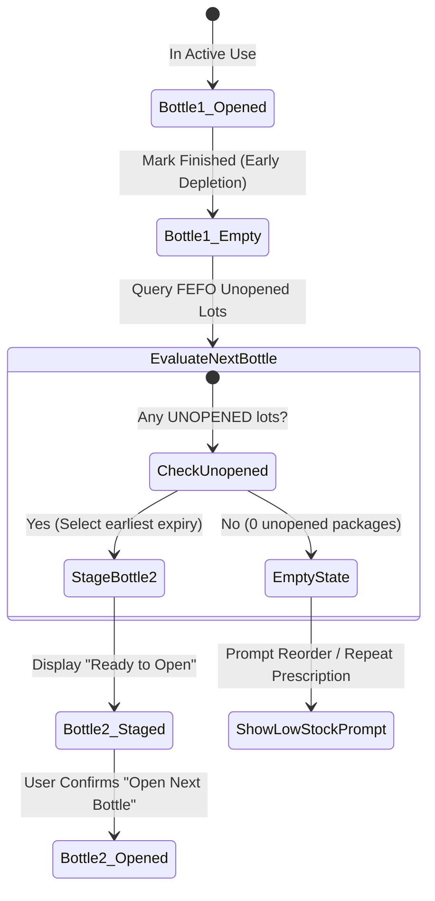

# Nuvilo Phase 9 Addendum: Domain Architecture & Medication Accounting Audit
**Agent 1 Deliverable — Domain Architecture, Inventory Accounting & Early Package Depletion Design**  
**Date:** 2026-11-12  
**Status:** Complete / Approved Specification  
**Author:** Agent 1 (Domain Architecture & Medication Accounting Auditor)  
**Target Audience:** Coordinator, Agent 2 (`inventory-eng`), Agent 3 (`notif-haptics-eng`), Agent 4 (`uiux-specialist`), Agent 5 (`qa-engineer`)

---

## Executive Summary & Scope

Nuvilo is an offline-first, premium personal medication tracking system governed by uncompromising patient safety and accounting integrity invariants (see `.agents/skills/novelo-medication-safety/SKILL.md`). In Phase 9, Nuvilo introduced discrete package-level inventory tracking (`StockLot`, `PackagingConfig`, `PackageStatus`) and FEFO allocation across multiple medication forms (notably multi-dose eye drops, single-dose containers, and topical gels).

This audit resolves the real-world clinical and physical phenomenon of **Early Package Depletion**:
When a multi-dose package (such as a 10 mL bottle of eye drops nominally rated for ~300 drops) physically runs out after only 240 drops have been taken (across 120 confirmed doses), 60 drops of theoretical balance remain registered in the system.

This document delivers:
1. **System Audit**: Verification of the immutable stock ledger, `ScaledQuantity` fixed-point arithmetic, discrete package lot management, FEFO queue algorithms, and database migrations (`v1 -> v4`).
2. **Early Package Depletion Accounting Design**: Exact mathematical reconciliation ensuring the remaining 60 units are written off via an immutable, compensating ledger movement (`WASTAGE` with explicit depletion reason/note) without drift.
3. **Zero Dose Fabrication Guardrail**: Proof that medication dose history and adherence statistics remain 100% untouched and uncorrupted (zero synthetic doses).
4. **Staged Next-Bottle Transition**: Deterministic FEFO selection of the next unopened package presented as "Ready to Open" with mandatory user confirmation prior to unsealing.
5. **Safe Reversal Workflow (`reopenDepletedPackage`)**: Idempotent compensating ledger restoration if a package was marked finished in error.
6. **Educational Insight**: Non-judgmental, clinically grounded patient explanation regarding drop volume variability, physical dispensing factors, and repeat prescription timing.
7. **Cross-Agent Interface Contracts**: Exact Kotlin function signatures, data models, and database migration guidance for Agent 2 (`inventory-eng`) and downstream agents.

---

## 1. Audit of Existing Subsystems & Accounting Foundations

### 1.1 Fixed-Point Scaled Quantity (`ScaledQuantity`)
- **Scaling Factor**: Fixed scale factor $S = 1{,}000$ (`SCALE = 1000L`), representing thousandths of a unit ($10^{-3}$).
  - 1 tablet = $1{,}000$ raw.
  - 0.5 tablets = $500$ raw.
  - 1 eye drop = $1{,}000$ raw.
  - 2.25 mL = $2{,}250$ raw.
- **Safety Invariant**: Strictly zero `Float` or `Double` arithmetic anywhere in balance derivation or dose measurement. `rawScaledValue: Long` guarantees 64-bit signed integer safety, preventing cumulative precision drift or IEEE-754 representation flaws.
- **Formatting & Parsing**: `toDisplayString()` safely formats whole and decimal numbers without trailing zeros; `fromDisplayString()` pads or truncates safely to exactly 3 decimal places.
- **Audit Verdict**: Fully compliant with safety guidelines.

### 1.2 Append-Only Stock Ledger (`StockLedgerCalculator`)
- **Single Source of Truth**: Inventory is never stored as an unbacked mutable counter. It is computed strictly as:
  $$\text{Current Balance} = \text{Opening Balance} + \sum \text{Inflows} - \sum \text{Outflows}$$
  Where:
  - $\text{Inflows} \in \{\text{OPENING\_BALANCE}, \text{RESTOCK}, \text{ADJUSTMENT\_IN}, \text{DOSE\_REVERSAL}\}$
  - $\text{Outflows} \in \{\text{DOSE\_TAKEN}, \text{DOSE\_ASSUMED}, \text{ADJUSTMENT\_OUT}, \text{WASTAGE}\}$
- **Unit Boundary Protection**: Every ledger entry must match `openingUnit`. Mismatches throw `IncompatibleUnitsException`.
- **Occurrence Idempotency**: Tracks `netDeductionsPerOccurrence`. Multiple calls for the same `doseOccurrenceId` throw `DuplicateDoseDeductionException`.
- **Reversal Auditability**: Historical dose status corrections append a `DOSE_REVERSAL` entry; original records are never deleted or modified.
- **Audit Verdict**: Fully sound. Package depletion must conform strictly to these ledger dynamics.

### 1.3 Package-Level Inventory Architecture (`StockLot` & `PackagingConfig`)
- **Model Separation**:
  - `PackagingConfig`: Container format (`PackageType`), nominal content count (`contentsPerPackage`), post-opening shelf life in days (`discardAfterOpeningDays`), and tracking precision (`TrackingPrecision`).
  - `StockLot`: Discrete physical package instance on the user's shelf. Contains `initialQuantity`, `remainingQuantity`, `expiryDateEpochMs`, `openedAtEpochMs`, `discardAfterOpeningEpochMs`, and `packageStatus`.
- **Lifecycle States (`PackageStatus`)**:
  - `UNOPENED`: Sealed. Discard-after-opening clock inactive.
  - `OPENED`: Active in-use container. Clock actively ticking down toward `discardAfterOpeningEpochMs`.
  - `EMPTY`: All usable contents consumed or depleted.
  - `EXPIRED`: Manufacturer expiry reached (`expiryDateEpochMs <= nowMs`).
  - `DISCARDED`: Manually discarded prior to empty (e.g. 28-day open limit reached, damaged, or contaminated).
- **Audit Verdict**: The existing architecture handles package opening and discard, but lacks an explicit, first-class workflow for **Early Depletion** where a bottle is physically finished while `remainingQuantity > 0`.

### 1.4 FEFO Allocation Policy
- Implemented in `StockLedgerCalculator.allocateDoseAgainstPackages()`:
  1. Filters out `EMPTY`, `EXPIRED`, `DISCARDED`, past-manufacturer-expiry, and past-discard-after-opening lots.
  2. Prioritizes already `OPENED` packages (ordered by earliest `effectiveDiscardAfterOpeningEpochMs`, then `expiryDateEpochMs`, then `createdAtEpochMs`).
  3. Falls back to `UNOPENED` packages in FEFO order (`expiryDateEpochMs`, then `createdAtEpochMs`).
  4. Automatically transitions `UNOPENED -> OPENED` when debited, calculating `discardAfterOpeningEpochMs = nowMs + discardAfterOpeningDays * 86_400_000L`.
- **Audit Finding**: In manual or real-world administration, auto-opening an unopened package during a background dose event is desirable only when confirmed. If a bottle runs out early, the user needs an explicit UI action to mark it finished and review the next staged bottle before unsealing.

### 1.5 Database Migrations Review (`v1` through `v4`)
- `MIGRATION_1_2`: Added `stock_lots` table, `lot_id` in ledger, dose correction notes.
- `MIGRATION_2_3`: Added `prescriptions` and `prescription_events`.
- `MIGRATION_3_4`: Added packaging columns to `medications` and `stock_lots` with deterministic status backfills.
- Current database version: `version = 4`.
- **Audit Finding regarding Schema Evolution**:
  `StockLotEntity` currently defines:
  ```kotlin
  val discardedAtEpochMs: Long? = null,
  val discardReason: String? = null
  ```
  If Agent 2 adds `depleted_at_epoch_ms: Long?` and `depletion_reason: String?` directly to `StockLotEntity`, Room **requires** `MIGRATION_4_5` and bumping to `version = 5`.
  *Architecture Decision*: In Section 6, we specify both the exact `MIGRATION_4_5` script and a zero-migration fallback (using existing columns) so the lead architect can approve the cleanest path.

---

## 2. Early Package Depletion: Root Causes & Mathematical Design

### 2.1 The Clinical & Physical Phenomenon
Multi-dose ophthalmic bottles and pump sprays rarely yield their exact nominal capacity:
1. **Dispensing Angle Variance**: Clinical trials demonstrate that administering eye drops at a 45° angle vs a 90° vertical angle alters droplet volume by **20% to 30%** due to orifice wetting and gravitational meniscus dynamics.
2. **Squeeze Force**: Patients with arthritis or tremor often apply inconsistent squeeze pressure, expelling twin droplets or large drops.
3. **Priming & Testing**: Patients frequently release a test drop into the air or tissue before targeting the eye.
4. **Manufacturer Tolerances**: A 10 mL bottle nominally containing 300 drops (based on 30 drops/mL) may contain 270–320 actual drops.

When the bottle runs out after 240 drops taken:
$$\text{Nominal Capacity } (Q_{\text{initial}}) = 300\text{ drops}$$
$$\text{Doses Taken } (N_{\text{taken}}) = 120\text{ administrations } \times 2\text{ drops/admin} = 240\text{ drops}$$
$$\text{Theoretical Remaining } (Q_{\text{rem}}) = 60\text{ drops}$$
$$\text{Physical Reality } = 0\text{ drops remaining (Bottle Empty)}$$

### 2.2 Ledger Accounting Invariant
To maintain the mathematical invariant:
$$\sum_{\text{active lots}} \text{StockLot.remainingQuantity} \equiv \text{Medication.StockBalance.currentBalance}$$
The 60 unharvested drops must be retired through an immutable compensating ledger outflow.

#### Accounting Equations:
1. **Target Package State**:
   $$\text{StockLot.remainingQuantity}_{\text{new}} = \text{ScaledQuantity.ZERO}$$
   $$\text{StockLot.packageStatus}_{\text{new}} = \text{PackageStatus.EMPTY}$$
2. **Compensating Outflow Magnitude**:
   $$Q_{\text{comp}} = Q_{\text{rem}} = \text{ScaledQuantity.ofWhole}(60) \quad (60{,}000\text{ raw})$$
3. **Ledger Entry Attributes**:
   - `movementType`: `MovementType.WASTAGE` (Outflow)
   - `quantity`: $Q_{\text{comp}}$
   - `lotId`: `lot.id` (strictly bound to the depleted bottle)
   - `doseOccurrenceId`: `null` (CRITICAL: Not a dose!)
   - `reason`: `"Early package depletion: Bottle ran out earlier than expected (240 taken of 300 nominal)"`
   - `isEstimate`: `true`

---

## 3. Mandatory Safety Guardrail: Zero Dose Fabrication & Adherence Isolation

### 3.1 The Golden Rule of Patient Safety
> **Under NO circumstances may an early package depletion event create synthetic dose records or alter historical dose occurrences.**

### 3.2 Clinical & Medical Rationale
1. **Adherence Integrity**: Ingesting or instilling medication is a clinical physiological event. Inventory depletion is a physical packaging event. Conflating the two would corrupt the patient's medical record.
2. **Clinical Danger (Overdose Risk)**: If 30 dummy doses of 2 drops each were inserted into `dose_events` to account for the 60 missing drops, an attending physician, carer, or hospital team reviewing the adherence log would conclude the patient had taken 150% to 200% of their prescribed regimen, creating acute clinical confusion or suspected toxicity.
3. **Adherence Score Preservation**:
   Adherence in Nuvilo is calculated strictly as:
   $$\text{Adherence Rate} = \frac{\text{Confirmed Taken} + \text{Assumed Taken}}{\text{Eligible Scheduled Past Doses}}$$
   The 120 taken doses represent a genuine, verified adherence of 100% across those 120 occurrences. Writing off 60 unused drops in inventory must **not** alter the numerator or denominator of adherence.

### 3.3 Architectural Separation Proof
`AdherenceCalculator.kt` evaluates adherence strictly from:
```kotlin
fun resolveOccurrencesForRange(
    medications: List<Medication>,
    schedules: List<ScheduleDefinition>,
    recordedEvents: List<DoseOccurrence>,
    startDate: LocalDate,
    endDate: LocalDate,
    zoneId: ZoneId,
    evaluationEpochMs: Long
): List<ResolvedDoseOccurrence>
```
`AdherenceCalculator` never queries `StockLot` or `StockLedgerEntry`. Because `depletePackage()` touches exclusively `StockLot` and `StockLedgerEntry`, the entire adherence subsystem and dose history screen remain **100% mathematically and architecturally untainted**.

---

## 4. Staged Next-Bottle Transition Design

When Bottle #1 is marked as finished:


### 4.1 Why Auto-Opening Must Be Prevented
A sealed ophthalmic bottle remains sterile and stable until its manufacturer expiry date (often 12–24 months). The moment a bottle is opened, its 28-day sterility timer starts ticking:
$$\text{discardAfterOpeningEpochMs} = \text{nowEpochMs} + (28 \times 86{,}400{,}000\text{ ms})$$
If Nuvilo automatically marked Bottle #2 as `OPENED` immediately upon Bottle #1's depletion:
- If the user was traveling without Bottle #2, or delayed opening it for 3 days, 3 valuable days of safe shelf life would be prematurely burned.
- Therefore, Bottle #2 must be transitioned to a **`STAGED` / `READY_TO_OPEN`** presentation state, requiring user confirmation before stamping `openedAtEpochMs`.

### 4.2 FEFO Selection Rules for the Next Package
1. Query lots for `medicationId` where `packageStatus == PackageStatus.UNOPENED`.
2. Filter out lots where `expiryDateEpochMs != null && expiryDateEpochMs <= nowEpochMs`.
3. Sort candidate lots:
   - Primary: `expiryDateEpochMs ASC` (lots without expiry sorted to the end: `Long.MAX_VALUE`).
   - Secondary: `createdAtEpochMs ASC` (FIFO tie-breaker).
4. Head of list becomes `stagedNextPackage`.

### 4.3 Zero Unopened Packages Behavior
If no unopened eligible packages exist:
1. `stagedNextPackage = null`.
2. UI displays an explicit alert card:
   - Title: *"No unopened bottles remaining"*.
   - Description: *"You have finished Bottle #1 and have no backup bottles in stock. Please restock or request a prescription repeat immediately."*
   - Direct CTA: *"Log Restock"* / *"Request Repeat"*.

---

## 5. Safe Correction & Reversal Workflow (`reopenDepletedPackage`)

### 5.1 The Accidental Click Scenario
A user tapping the screen may accidentally hit "Mark as finished" or mistake an in-use bottle for an empty one. Nuvilo must provide a frictionless, safe, and fully auditable reversal.

### 5.2 Reversal Algorithm (`reopenDepletedPackage`)
1. **Precondition Validation**:
   - Verify package `lotId` exists.
   - Verify `packageStatus == PackageStatus.EMPTY`.
   - Find the compensating depletion entry in `stock_ledger_entries` for `lotId` (identified by `lot_id == lotId` and `movement_type == 'WASTAGE'`).
2. **Compensating Inflow Movement**:
   - Write an immutable `MovementType.ADJUSTMENT_IN` entry:
     - `quantity`: Exact quantity written off during depletion ($Q_{\text{comp}}$).
     - `unit`: `lot.unit`.
     - `lotId`: `lot.id`.
     - `reason`: `"Reversal of early package depletion: Bottle reopened by user"`.
     - `timestampEpochMs`: `System.currentTimeMillis()`.
3. **Lot State Restoration**:
   - Restore `remainingQuantity` to previous balance ($Q_{\text{rem}}$).
   - Restore `packageStatus` to `PackageStatus.OPENED`.
   - Preserve original `openedAtEpochMs` and `discardAfterOpeningEpochMs`.
   - Clear or annotate depletion audit notes.
4. **Interim Next-Bottle Conflict Handling**:
   - If the user had already opened Bottle #2 before realizing Bottle #1 wasn't empty:
     - Both Bottle #1 and Bottle #2 will now be in `OPENED` status.
     - The UI presents a gentle multi-bottle warning: *"You currently have two bottles open. Please prioritize using Bottle #1 (expires in X days) before Bottle #2."*

---

## 6. Educational Insight Design: "This bottle finished earlier than estimated"

### 6.1 Clinical Voice & Tone
- **Tone**: Empathetic, clinical, informative, and reassuring.
- **Goal**: Prevent patient anxiety or guilt. Ensure the patient understands that drop count variance is normal physics, while equipping them with best-practice instillation technique.

### 6.2 Recommended Copy & Insight Card Content
```markdown
### 💡 Eye Drop Usage Insight: Why Bottles Finish Early
It looks like this bottle yielded approximately 240 drops rather than the estimated 300. This is very common and completely normal:

- **Dropper Angle**: Holding the bottle at an angle rather than completely vertical (90°) produces significantly larger drops (up to 30% more liquid per drop).
- **Gentle Squeeze**: Squeezing hard can accidentally release twin drops or a stream.
- **Factory Fill**: Bottles have minor filling tolerances from the manufacturer.

**Tip for your next bottle:**
Hold the bottle as close to vertical as comfortable, tilt your head back, pull down your lower eyelid to form a pocket, and gently press the base until a single drop falls.

*Reminder:* Always request your repeat prescription when you open your last bottle so you never run out unexpectedly.
```

---

## 7. Interface Contracts for Engineering Teams

### 7.1 Contract for Agent 2 (`inventory-eng`)

#### Data Classes & Enums (to add to `domain/model/PackagingModels.kt`):
```kotlin
enum class DepletionReason(val displayName: String, val ledgerReasonCode: String) {
    EMPTY_NO_DROPS_LEFT("Bottle is completely empty", "BOTTLE_EMPTY"),
    EXCESSIVE_DISPENSING("Multiple drops / accidental spillage", "EXCESSIVE_DISPENSING"),
    LEAKING_OR_DAMAGED("Dropper damaged or bottle leaking", "BOTTLE_DAMAGED"),
    CONTAMINATED("Tip touched eye / contaminated", "CONTAMINATED"),
    LOST_OR_DISCARDED("Lost or discarded", "LOST_DISCARDED"),
    OTHER("Other reason", "OTHER")
}

data class EarlyDepletionOutcome(
    val depletedLot: StockLot,
    val compensatingEntry: StockLedgerEntry?,
    val stagedNextLot: StockLot?
)

data class ReopenDepletionOutcome(
    val reopenedLot: StockLot,
    val reversalEntry: StockLedgerEntry
)
```

#### Domain Methods on `StockLedgerCalculator.kt`:
```kotlin
fun depletePackageEarly(
    lot: StockLot,
    reason: DepletionReason,
    userNote: String? = null,
    nowEpochMs: Long = System.currentTimeMillis(),
    movementId: String = java.util.UUID.randomUUID().toString()
): EarlyDepletionOutcome

fun reopenDepletedPackage(
    lot: StockLot,
    depletionLedgerEntry: StockLedgerEntry,
    userNote: String? = null,
    nowEpochMs: Long = System.currentTimeMillis(),
    movementId: String = java.util.UUID.randomUUID().toString()
): ReopenDepletionOutcome
```

#### Repository Methods on `NoveloRepository.kt`:
```kotlin
suspend fun depletePackage(
    lotId: String,
    reason: DepletionReason,
    userNote: String? = null,
    nowEpochMs: Long = System.currentTimeMillis()
): Result<EarlyDepletionOutcome>

suspend fun reopenDepletedPackage(
    lotId: String,
    reason: String = "Accidental depletion correction",
    nowEpochMs: Long = System.currentTimeMillis()
): Result<ReopenDepletionOutcome>

suspend fun getStagedNextPackage(
    medicationId: String,
    nowEpochMs: Long = System.currentTimeMillis()
): StockLot?
```

### 7.2 Database Schema Options for `NoveloDatabase`

#### Option A: Dedicated Depletion Columns with `MIGRATION_4_5` (Recommended for pure domain clarity)
```sql
-- Migration 4 to 5
ALTER TABLE stock_lots ADD COLUMN depleted_at_epoch_ms INTEGER;
ALTER TABLE stock_lots ADD COLUMN depletion_reason TEXT;
ALTER TABLE stock_lots ADD COLUMN depletion_note TEXT;
```
If Option A is chosen by the team:
- Increment `version = 5` in `NoveloDatabase.kt`.
- Export schema `5.json`.
- Add test in `NoveloDatabaseMigrationTest.kt`.

#### Option B: Zero-Migration Compatible Mapping (Fastest, zero schema breakage)
- Store `depletion_reason` and `userNote` inside existing `discard_reason` and `notes` columns with a structured prefix:
  `discard_reason = "DEPLETED[${reason.ledgerReasonCode}]: ${userNote ?: reason.displayName}"`
  `discarded_at_epoch_ms = nowEpochMs`
- Set `package_status = 'EMPTY'`.
- Fully supported by existing Room version 4 schema without requiring DB migration.

---

## 8. Summary Checklist for Swarm Execution

| Component | Responsible | Target Deliverable / Invariant | Status |
|---|---|---|---|
| **Domain Logic** | Agent 1 (`domain-auditor`) | `docs/phase9/AGENT_1_DOMAIN_AUDIT.md` published | **COMPLETE** |
| **Data/Ledger Impl** | Agent 2 (`inventory-eng`) | `depletePackage()`, compensating `WASTAGE`, next staged lot | In Progress |
| **Notifications/Haptics** | Agent 3 (`notif-haptics-eng`) | `PACKAGE_DEPLETED` haptic, immediate runway refresh | In Progress |
| **UI/UX Components** | Agent 4 (`uiux-specialist`) | "Mark bottle as finished" dialog, next bottle prompt, educational card | In Progress |
| **Independent QA** | Agent 5 (`qa-engineer`) | 240/300 acceptance test, zero dose fabrication verification | Pending Impl |

---
*Signed by Agent 1 (Domain Architecture & Medication Accounting Auditor)*
