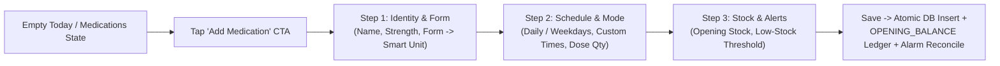
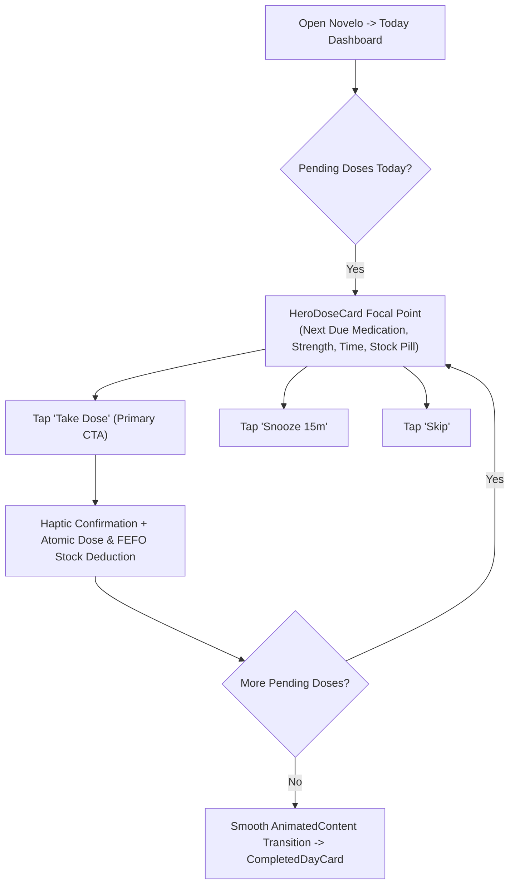
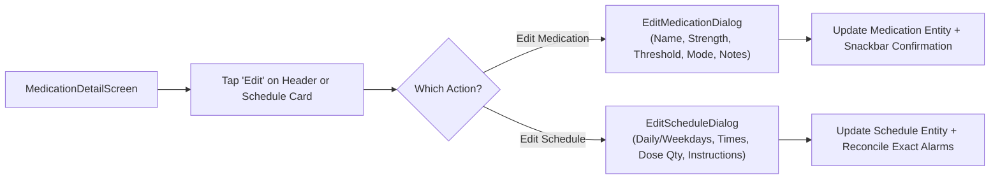
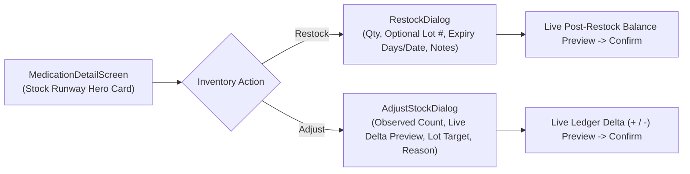
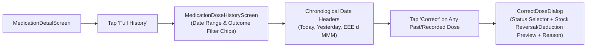
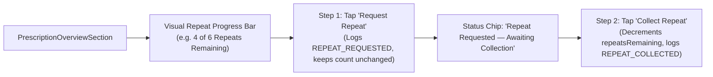
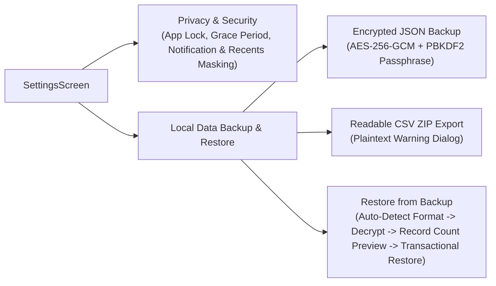

# Novelo Phase 8 — Core User Journeys & Interaction Flows

This document maps the 7 primary clinical and operational user journeys in **Novelo**, detailing how the Phase 8 UI/UX overhaul minimizes cognitive load, reduces tap counts, and preserves medication safety invariants.

---

## Journey 1: First-Time Onboarding & Creating a Medication with Schedule

### Key UX Enhancements
1. **Actionable Empty States:** Both `DashboardScreen` and `MedicationListScreen` display a clear, welcoming clinical illustration card with direct onboarding guidance rather than a dead-end blank screen.
2. **Progressive Disclosure (3-Step Wizard):** Instead of a 9-field scrolling dialog, the wizard groups inputs into three logical stages (`1. Medication`, `2. Schedule`, `3. Inventory`) with an animated step indicator bar.
3. **Smart Dosage Form → Unit Mapping:** Selecting `Capsule` automatically defaults the stock unit to `Capsules`; selecting `Inhaler` defaults to `Puffs (Estimated)` with an immediate explanation of `ESTIMATED` stock tracking.
4. **Full Schedule Flexibility:** Users can choose `Every Day` or `Specific Days of the Week` (`M T W T F S S`), select quick time presets (`08:00`, `12:00`, `18:00`, `20:00`, `22:00`) or add any custom `HH:MM` time, and set the exact dose quantity per occurrence.

---

## Journey 2: Daily Dose Recording (Confirm, Snooze, Skip & Completed Day)

### Key UX Enhancements
1. **Unmistakable Visual Hierarchy:** `HeroDoseCard` is the single dominant surface on the Today screen, featuring a high-contrast primary container, clear dosage pill, and a full-width `Take Dose` button separated from secondary `Snooze 15m` and `Skip` actions to prevent accidental taps.
2. **Tactile & Visual Feedback:** Confirming a dose triggers haptic feedback, smoothly animates the daily adherence progress bar (`animateFloatAsState`), and transitions the Hero card to the next pending dose or the celebratory `CompletedDayCard`.
3. **No Catch-Up Dose Recommendations:** In strict compliance with Novelo's medical guardrails, overdue or missed doses never suggest doubling up or taking catch-up doses.

---

## Journey 3: Editing an Existing Medication or Regimen Schedule

### Key UX Enhancements
1. **In-Place Clinical Maintenance:** Users no longer have to archive and recreate a medication if their doctor adjusts their dosage strength, low-stock threshold, or daily schedule times.
2. **Automatic Alarm Reconciliation:** Saving an updated schedule immediately invokes `alarmScheduler.reconcileUpcomingReminders()` so upcoming exact alarms reflect the new times.

---

## Journey 4: Stock Restocking, Batch Lot FEFO Tracking & Manual Recount Adjustment

### Key UX Enhancements
1. **Stock Runway Hero Card:** Surfaces current balance in large display typography alongside estimated days remaining (`~14 days left`) and a visual status pill (`Healthy Stock` vs `Low Stock — Reorder Soon`).
2. **FEFO Active Batch Badge:** In the collapsible Batch Lots section, the lot currently prioritized by First-Expired, First-Out (`FEFO`) deduction is explicitly badged with `"Active FEFO Batch"`.
3. **Before → After Impact Previews:** Both `RestockDialog` and `AdjustStockDialog` display a real-time impact preview card showing `Current Balance → New Balance` and the exact ledger movement type before the user taps confirm.

---

## Journey 5: Historical Dose Review & Auditable Dose Correction

### Key UX Enhancements
1. **Chronological Date Grouping:** History items are grouped under clean date headers so users can immediately orient themselves across multi-week logs.
2. **Explicit Stock Ledger Consequence Preview:** When correcting a dose in `CorrectDoseDialog` (e.g., changing `Taken` → `Skipped`), an inline preview banner explains that a compensating `+1 tab DOSE_REVERSAL` will be appended to the stock ledger automatically.

---

## Journey 6: Prescription & Repeat Tracking

### Key UX Enhancements
1. **Visual Repeat Counter:** A segmented progress bar makes remaining repeats vs authorised repeats scannable at a glance.
2. **Two-Step Repeat Clarity:** Clearly distinguishes requesting a repeat (which marks a pending request without prematurely decrementing repeats) from collecting the repeat at the pharmacy.
3. **Timeline Audit History:** `PrescriptionHistoryDialog` renders every creation, update, repeat request, and collection event along a vertical audit timeline.

---

## Journey 7: Privacy Lock & Encrypted SAF Backup / Transactional Restore

### Key UX Enhancements
1. **Clear Backup Format Comparison:** Distinct visual cards explain the difference between **Encrypted Full Backup (`.novelo.json`)** (recommended for safe device migration) and **Readable Spreadsheet Archive (`.zip`)** (for personal spreadsheet analysis).
2. **Structured Restore Verification:** Before any local data is replaced, `RestorePreviewDialog` presents a clean 2x3 metric grid of validated entities (`Medications`, `Schedules`, `Dose Records`, `Stock Lots`, `Ledger Entries`, `Prescriptions`) and a clear overwrite warning.
